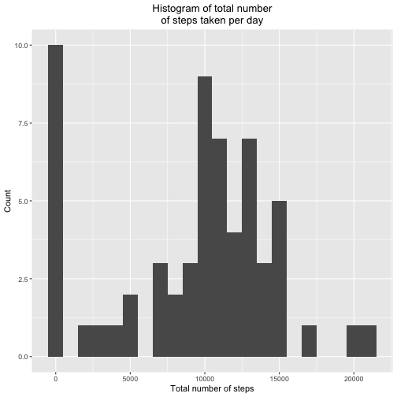
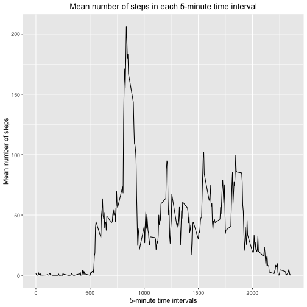
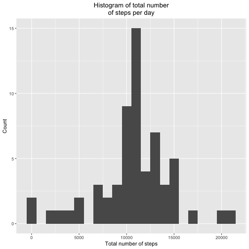
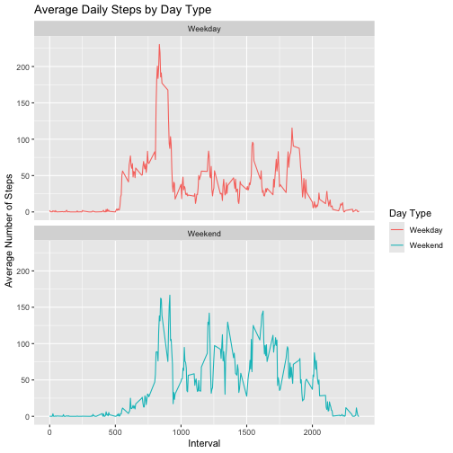

The purpose of the following analysis is to synthesize data from a personal activity monitoring device. The analysis answers the questions "what is the mean total number of staps taken per day", "what is the average daily activity pattern", and "are there difference in the activity patterns between weekdays and weekends?" 

## Loading and preprocessing the data

The following lines of code load the data. If the file 'activity.zip' has not been previously unzipped, it is being unzipped. Afterward, the data is being read in using 'read.csv'.


```r
# If the file has not already been unzipped, unzip it
if (!(file.exists("./activity.csv"))) {
  unzip("./activity.zip")
}

# Load the data file
activity <- read.csv('activity.csv')
```

The following lines of code prints the first rows of the loaded data file and summarize the data.


```r
# Print the first rows of data
head(activity)
```

```
##   steps       date interval
## 1    NA 2012-10-01        0
## 2    NA 2012-10-01        5
## 3    NA 2012-10-01       10
## 4    NA 2012-10-01       15
## 5    NA 2012-10-01       20
## 6    NA 2012-10-01       25
```

```r
# Summarize the data
summary(activity)
```

```
##      steps            date              interval     
##  Min.   :  0.00   Length:17568       Min.   :   0.0  
##  1st Qu.:  0.00   Class :character   1st Qu.: 588.8  
##  Median :  0.00   Mode  :character   Median :1177.5  
##  Mean   : 37.38                      Mean   :1177.5  
##  3rd Qu.: 12.00                      3rd Qu.:1766.2  
##  Max.   :806.00                      Max.   :2355.0  
##  NA's   :2304
```

One of the columns contains dates. The following lines of code transform the column into the date format. This will allow me to use these dates to create time series and other plots.


```r
# Change the format of the column date from char to date format
activity$date <- as.Date(activity$date)
```

I will use ggplot2 to plot the data. The following lines of code load the ggplot2 library.


```r
# Load ggplot2
library(ggplot2)
```

## What is mean total number of steps taken per day?

The following lines of code calculate the total number of steps taken each day.


```r
tot_steps <- aggregate(activity["steps"], by=activity["date"], sum, na.rm = TRUE)
```

To visualize this data, the following lines of code plot a histogram of the total number of steps taken each day.


```r
# Histogram
hist_tot_steps <- ggplot(tot_steps, aes(x=steps)) +
  geom_histogram(binwidth = 1000) +
  ggtitle("Histogram of total number\nof steps taken per day") + 
  theme(plot.title = element_text(hjust = 0.5)) + 
  xlab("Total number of steps") + ylab("Count")
print(hist_tot_steps)
```



Next, I calculate the mean and median of total number of steps taken each day. The mean number of total steps taken each day is 9354.23 steps. The median number of total steps taken each day is 10395 steps.


```r
mean(tot_steps$steps, na.rm = TRUE)
```

```
## [1] 9354.23
```

```r
median(tot_steps$steps, na.rm = TRUE)
```

```
## [1] 10395
```

## What is the average daily activity pattern?

To visualize the average daily activity pattern, I will plot the average number of steps taken in each 5-minute time interval, averaged across days.

The following lines of code average the number of steps taken in each 5-minute time interval across days.


```r
interval_steps <- aggregate(activity["steps"], by=activity["interval"], mean, na.rm = TRUE)
```

Afterward, I create a time series plot to visualize the average daily activity pattern. The following lines of code generate a time series plot that visualizes the average number of steps taken each 5-minute time interval, averaged across days.


```r
time_series_interval_steps <- ggplot(interval_steps, aes(x=interval, y=steps)) +
  geom_line() + ggtitle("Mean number of steps in each 5-minute time interval") + 
  theme(plot.title = element_text(hjust = 0.5)) + 
  xlab("5-minute time intervals") + ylab("Mean number of steps")
print(time_series_interval_steps)
```



Next, I find the 5-minute time interval, which on average across all the days in the dataset, contains the maximum number of steps. This is the time interval starting at 835 minutes after midnight, or at 1:55 pm.


```r
interval_steps[which.max(interval_steps$steps),]$interval
```

```
## [1] 835
```

## Imputing missing values

The dataset contains several days/5-minute time intervals for which data is missing (coded as N/A). To prevent these missing values from biasing data analyses, I will impute them.

As a first step, I am calculating the total number of missing values in the dataset. A total of 2304 values are missing in the dataset.


```r
sum(is.na(activity$steps))
```

```
## [1] 2304
```

Next, I will impute the missing values. I will use a simple strategy and fill the missing values using the average number of total steps across days for that 5-minute time interval.

The following lines of code create a copy of our dataset, and I will impute the missing values on this new dataset.


```r
activity_imputed <- activity
```

Here, I match the average number of steps in each 5-minute time interval to each combination of days/5-minute time interval, and then fill in any missing values using the matched average.


```r
imputed_steps <- interval_steps$steps[match(activity_imputed$interval,interval_steps$interval)]
activity_imputed[which(is.na(activity_imputed$steps)),]$steps <- imputed_steps[which(is.na(activity_imputed$steps))]
```

To confirm that all missing values were replaced, I am again calculating the total number of missing values in the dataset. It is zero in the dataset with imputed values, confirming that all missing values have been replaced.


```r
sum(is.na(activity_imputed$steps))
```

```
## [1] 0
```

To visualize the data with imputed missing values and compare it to the data without imputed missing values, I am plotting a histogram of the total number of steps taken each day using the data with imputed missing values.

The following lines of code calculate the total number of steps taken each day and then plot the histogram.


```r
tot_steps_imputed <- aggregate(activity_imputed["steps"], by=activity_imputed["date"], sum)

# Histogram
hist_tot_steps_imputed <- ggplot(tot_steps_imputed, aes(x=steps)) +
  geom_histogram(binwidth = 1000) +
  ggtitle("Histogram of total number\nof steps per day") + 
  theme(plot.title = element_text(hjust = 0.5)) + 
  xlab("Total number of steps") + ylab("Count")
print(hist_tot_steps_imputed)
```



To quantify differences between the two datasets, I am calculating the mean and median of the number of steps taken per day. Both, the mean and median number of total steps taken each day is 10766.19 steps. The mean number of total steps taken each day increased by 1411.96 steps after imputing the missing values. The median number of total steps taken each day decreased by 371.91 steps.


```r
mean(tot_steps_imputed$steps)
```

```
## [1] 10766.19
```

```r
median(tot_steps_imputed$steps)
```

```
## [1] 10766.19
```

## Are there differences in activity patterns between weekdays and weekends?

To determine whether there are differences in the average daily activity pattern between weekdays and weekends, I first create a new factor variable with two levels ("Weekday" and "Weekend") that indicates whether a given date is a weekday or weekend.


```r
activity_imputed$weekend <- sapply(activity_imputed$date, function(x) {
  if(weekdays(x) == "Saturday" | weekdays(x) == "Sunday")
  {y <- "Weekend"}
  else {y <- "Weekday"}
  y
})
```

Next, I average the number of steps taken in each 5-minute time interval across weekdays or weekend days.


```r
weekend_steps_imputed <- aggregate(steps ~ interval + weekend, activity_imputed, mean)
```

Lastly, I create a panel plot that consists of two time series plot. The upper time series plot visualizes the average daily activity pattern on weekdays, and the lower time series plot visualizes the average daily activity pattern on weekend days. The following lines of code generate the panel plot, consisting of these two time series plots.


```r
time_series_weekend <- ggplot(weekend_steps_imputed, aes(x = interval , y = steps, color = weekend)) + geom_line() + ggtitle("Average Daily Steps by Day Type") + 
  xlab("Interval") + ylab("Average Number of Steps") +
  facet_wrap(~weekend, ncol = 1, nrow=2) + scale_color_discrete(name = "Day Type")
print(time_series_weekend)
```


